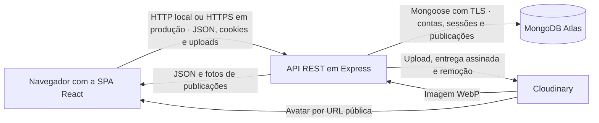
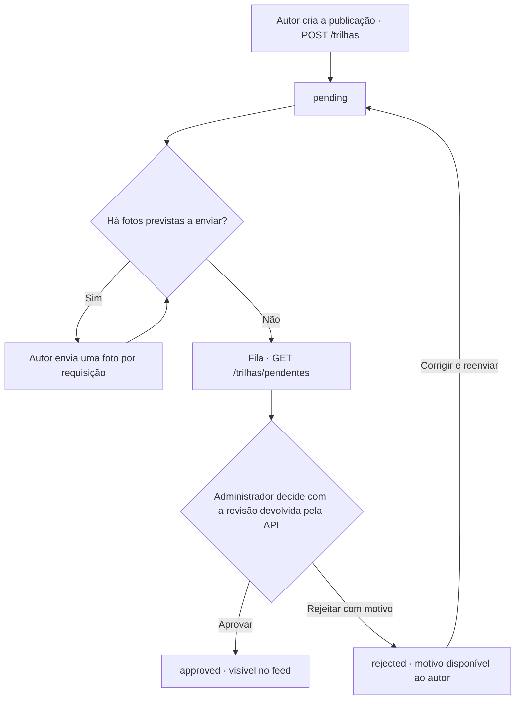
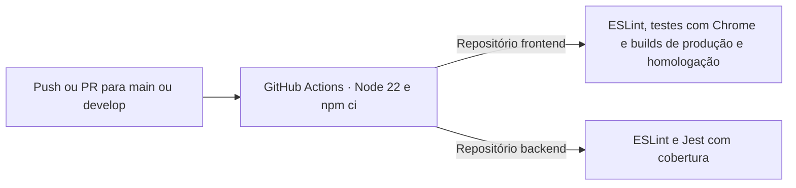

# Pé na Trilha · Backend

[](package.json)
[](package-lock.json)
[](.github/workflows/ci.yml)

API REST do **Pé na Trilha**, projeto acadêmico que reúne relatos, características e fotos de trilhas, praias e cachoeiras para quem planeja atividades ao ar livre. A API gerencia contas, sessões, publicações, moderação e mídia. O frontend usa esses dados para apresentar o feed, o perfil e a progressão das medalhas.

**Repositórios** · Backend (este repositório) · [Frontend e fluxos de navegação](https://github.com/DaviLLi/pe-na-trilha-frontend)

[Arquitetura](#arquitetura) · [API](#referência-da-api) · [Execução local](#execução-local) · [Testes e CI](#testes-e-integração-contínua) · [Nuvem](#publicação-em-nuvem)

## Arquitetura



A SPA chama a API por HTTP em ambiente local e por HTTPS na configuração de nuvem. O Express centraliza validação, controle de acesso e regras de negócio. O Atlas persiste os registros e os metadados de mídia com o Mongoose. O Cloudinary armazena os arquivos, gera variantes e fornece as imagens para entrega. Em nuvem, o bundle estático e o processo da API podem ser publicados separadamente, enquanto banco e mídia ficam em serviços gerenciados.

| Tecnologia | Uso |
| --- | --- |
| Node.js 22 LTS e Express `5.2.1` | API JavaScript com ES Modules, roteamento e middleware. |
| MongoDB Atlas e Mongoose `9.12.3` | Persistência, índices, validação por schema e transações. |
| SDK Cloudinary `2.11.0` | Armazenamento de mídia, variantes WebP e URLs assinadas para consumo pela API. |
| bcrypt `6.0.0` e jose `6.2.16` | Hash de senhas e assinatura e validação de JWT. |
| Multer `2.5.0`, file-type `22.3.0`, CORS `2.8.6` e dotenv `17.4.2` | Upload multipart, verificação de formato, origens permitidas e configuração por ambiente. |
| Jest `30.5.2`, Supertest `7.2.2` e ESLint `10.15.0` | Testes de lógica e rotas HTTP e análise estática. |

As versões das dependências correspondem ao [lockfile](package-lock.json). O Node 22 é a série configurada na CI.

### Organização e dados

| Caminho | Responsabilidade |
| --- | --- |
| `src/server.js` e `src/app.js` | Inicialização, conexão, health check, encerramento e montagem do Express. |
| `src/config/` | Seleção de ambiente e destinos, MongoDB, Cloudinary, CORS e parâmetros de sessão. |
| `src/routes/` e `src/middlewares/` | Contratos HTTP, validação, autenticação, CSRF, propriedade, limites e tratamento de erros. |
| `src/controllers/`, `src/domain/` e `src/services/` | Casos de uso de conta, trilhas e mídia, regras de publicação, sessões e administração. |
| `src/models/` | Schemas Mongoose e índices. |
| `tests/`, `tools/` e `docs/` | Testes, comandos operacionais e documentação de apoio. |

| Modelo ou coleção | Dados |
| --- | --- |
| `Usuario` | Identidade, hash da senha, perfil `user` ou `admin`, referência da foto, versões dos documentos e data de aceite. E-mail e nome de usuário têm índices únicos. |
| `Trilha` | Título, descrição, endereço, referência ao autor, características e duração opcionais, fotos, status e histórico de moderação. |
| `AuthSession` e `RefreshToken` | Sessões revogáveis, hashes dos tokens de renovação e expiração com índices TTL. |
| `TentativaLogin` | Contadores de tentativas com expiração, reservados de maneira atômica. |
| `OperacaoImagem` | Estado da operação, identificação da mídia, tentativas, agendamento e reconciliação de arquivos. |
| `provisionamentoAdministrativo`, `confirmacoesAdministrativas` e `auditoriaAdministrativa` | Identificação do administrador principal, controle de tentativas de confirmação e registro de mudanças de papel. |

### Ciclo de uma publicação



O backend registra a publicação como `pending` e a fila de moderação só inclui pendências sem fotos previstas ainda a enviar. A decisão usa a revisão devolvida pela fila e uma atualização atômica. Se outra operação modificar a publicação antes da decisão, a API responde `409` e o administrador deve atualizar a fila. Publicações pendentes e rejeitadas permitem edição de conteúdo e de fotos pelo autor. As aprovadas permitem edição de características e duração. A exclusão é reservada ao autor. [Regras de moderação](docs/moderacao-publicacoes.md)

## Referência da API

As rotas abaixo são relativas à origem da API, sem prefixo `/api`. A API lê JSON nas operações de dados e `multipart/form-data` nos uploads. **Sessão** indica um JWT de acesso vinculado a uma sessão ativa. O frontend usa o cookie de acesso e envia `X-CSRF-Token` nas mutações protegidas. O middleware também aceita Bearer vinculado a uma sessão ativa nas rotas gerais. O gerenciamento de administradores exige cookie.

### Saúde, conta e sessão

| Método | Rota | Acesso e resultado |
| --- | --- | --- |
| `GET` | `/healthz` | Público. `200` com Mongoose conectado ou `503` se a conexão estiver indisponível. |
| `POST` | `/usuarios` | Público. Cria conta com papel `user` e aceite versionado. `201`. |
| `POST` | `/usuarios/login` | Origem autorizada. Recebe `identificador` e `senha`, responde `200` e define cookies. |
| `POST` | `/usuarios/refresh` | Origem autorizada e cookie de refresh. Rotaciona o token e renova os cookies. `200`. |
| `POST` | `/usuarios/logout` | Origem autorizada e sessão, com CSRF para cookie. Revoga a sessão e limpa os cookies. `204`. |
| `GET` | `/usuarios/me` e `/usuarios/csrf` | Sessão. Retornam o perfil da conta ou o token CSRF. `200`. |
| `PATCH` | `/usuarios/me` | Sessão. Atualiza `nomeCompleto`, `nomeUsuario` e/ou `email`. `200`. |
| `PUT` / `DELETE` | `/usuarios/me/foto-perfil` | Sessão. Substitui ou remove o avatar. `200`. |

O cadastro recebe `nomeCompleto`, `nomeUsuario`, `email`, `senha`, `aceiteTermos: true`, `versaoTermos` e `versaoPoliticaPrivacidade`. O servidor confere as versões vigentes e registra a data. Depois do login, o cliente consulta `GET /usuarios/csrf` e usa o valor de `csrfToken` nas mutações protegidas por cookie. [Rotas de usuários](src/routes/usuarioRoutes.js) · [Versões dos documentos](src/config/documentosLegais.js)

### Trilhas, fotos e administração

| Método | Rota | Acesso e resultado |
| --- | --- | --- |
| `GET` | `/trilhas` e `/trilhas/:id` | Público. Consultam publicações aprovadas. A lista aceita `?busca=termo`. `200`. |
| `GET` | `/trilhas/minhas` e `/trilhas/minhas/:id` | Sessão. Listam as publicações do próprio usuário ou consultam uma delas. `200`. |
| `POST` | `/trilhas` | Sessão. Cria uma publicação pendente. `201`. |
| `PATCH` / `PUT` | `/trilhas/:id` | Autor. Atualiza os campos permitidos para o status. `200`. |
| `DELETE` | `/trilhas/:id` | Autor. Exclui a publicação e registra a limpeza de mídias associadas. `204`. |
| `POST` | `/trilhas/:id/reenviar` | Autor. Retorna uma publicação rejeitada ao estado pendente. `200`. |
| `POST` | `/trilhas/:id/fotos` | Autor. Adiciona uma foto a uma publicação pendente ou rejeitada. `201`. |
| `PUT` / `DELETE` | `/trilhas/:id/fotos/:fotoId` | Autor. Substitui (`200`) ou remove (`204`) uma foto em estado editável da publicação. |
| `GET` | `/trilhas/:id/fotos/:fotoId/conteudo` | Público. Entrega WebP de uma publicação aprovada. `200`. |
| `GET` | `/trilhas/minhas/:id/fotos/:fotoId/conteudo` | Autor. Entrega WebP para a própria publicação. `200`. |
| `GET` | `/admin/trilhas/:id/fotos/:fotoId/conteudo` | Administrador. Entrega WebP na área administrativa. `200`. |
| `GET` / `POST` | `/trilhas/pendentes` / `/trilhas/:id/moderacao` | Administrador. Lista fila ou decide com `status`, `revisao` e `motivo` quando rejeita. `200`. |
| `GET` | `/admin/administradores` | Administrador principal com cookie. Lista administradores. `200`. |
| `POST` | `/admin/administradores/promover` e `/admin/administradores/remover` | Administrador principal com cookie e CSRF. Recebem o `email` da conta-alvo e a `senha` atual do operador. `204`. |

Para criar uma publicação, envie `titulo`, `descricao` e `endereco`. Opcionais incluem características do percurso, `duracao` no formato `{ "horas": 1, "minutos": 30 }` e `fotosPrevistas` de 1 a 5 para o fluxo de envio inicial. Uploads recebem exatamente um arquivo no campo `imagem`, de até **5 MiB**, JPEG, PNG ou WebP verificado pelo conteúdo. As rotas de entrega aceitam `?variante=miniatura` ou `?variante=detalhe`. [Rotas de trilhas](src/routes/trilhaRoutes.js) · [Rotas administrativas](src/routes/administradorRoutes.js) · [Validação de publicações](src/middlewares/validarTrilha.js)

Erros retornam JSON com `mensagem` e, em algumas validações, `erros`. Entre as respostas estão `400` para dados inválidos, `401` para sessão inválida, `403` para operação sem permissão ou CSRF inválido, `404` para recurso fora do escopo do solicitante ou inexistente, `409` para conflito, `413` para arquivo acima do limite e `429` no limitador. Falhas na integração de imagens podem retornar `502`, `503` ou `504` conforme a operação. É possível consultar a API local sem autenticação pelo health check.

```bash
curl -i http://127.0.0.1:3001/healthz
curl -G --data-urlencode 'busca=cachoeira' http://127.0.0.1:3001/trilhas
```

### Segurança e ciclo da mídia

- **Sessões.** Senhas têm hash bcrypt. O JWT de acesso expira em 15 minutos e o middleware verifica a sessão ativa e o papel atual no MongoDB. Os cookies são `HttpOnly` e os modos da aplicação usam `Secure`. A renovação rotaciona o refresh token, armazenado como hash, e o logout revoga a sessão. Operações protegidas por cookie validam CSRF vinculado à sessão. [Sessões](src/services/authSessionService.js) · [Cookies](src/config/authCookies.js)
- **Acesso e abuso.** O servidor verifica a origem do frontend para login, renovação e logout, limita tentativas de login por rede e identificador e expõe `Retry-After` via CORS. Autor, administrador e administrador principal têm permissões distintas. Alterações administrativas exigem confirmação da identidade e geram auditoria. [Primeiro administrador](docs/primeiro-administrador.md) · [Gerenciamento de administradores](docs/gerenciamento-administradores.md)
- **Fotos de publicações.** Os uploads novos usam entrega autenticada no Cloudinary. A API verifica o contexto de acesso, obtém a variante WebP assinada e transmite o conteúdo. Os contratos de publicação expõem rotas da API. Registros de mídia legada sem metadados válidos ficam sem link de entrega. O avatar usa uma URL pública. [Fotos de publicações](docs/fotos-privadas.md) · [Inventário de fotos](docs/photo-inventory.md)
- **Consistência.** Transações no MongoDB associam metadados e registram tarefas de limpeza nas alterações de mídia. Um processador retoma operações pendentes, protege arquivos ainda referenciados e registra falhas que excedem as tentativas. As transações exigem uma topologia MongoDB compatível. [Processador de imagens](src/services/processarOperacoesImagem.js)

## Execução local

Use **Node.js 22 LTS** (22.13 ou superior na série 22 para o ESLint), npm e um shell com `env`. Para iniciar a aplicação, obtenha acesso ao MongoDB Atlas e ao Cloudinary do ambiente escolhido. Para começar, use a homologação, com o banco e a chave de mídia próprios.

```bash
npm ci
test -f .env.homologation || cp .env.homologation.example .env.homologation
# Preencha os valores autorizados do ambiente.
npm run dev:homologation
```

| Ambiente | Arquivo do backend | Comando nos dois repositórios | API e frontend |
| --- | --- | --- | --- |
| Homologação | `.env.homologation` | `npm run dev:homologation` | API em `http://127.0.0.1:3001`, frontend em `http://127.0.0.1:5174`. |
| Produção executada localmente | `.env.production` | `npm run dev:production` | API em `http://localhost:3000`, frontend em `http://localhost:5173`. |

O frontend roda em `pe-na-trilha/` no [repositório da interface](https://github.com/DaviLLi/pe-na-trilha-frontend). Abra o endereço da tabela para manter o host compatível com CORS e cookies. O backend valida o destino SRV e o nome do banco de cada ambiente. O perfil local de produção usa recursos de produção e pode efetuar escritas.

| Configuração | Valores esperados |
| --- | --- |
| MongoDB de produção | `MONGO_URI_PRODUCTION` com URI `mongodb+srv` para o destino de produção e banco `pe_na_trilha`. |
| MongoDB de homologação | `MONGO_URI_HOMOLOGATION` para o banco `pe_na_trilha_homologacao` e `MONGO_HOST_HOMOLOGATION` para o seed autorizado indicado no exemplo. |
| Sessão e cookies | `JWT_SECRET` e `CSRF_SECRET` independentes, com pelo menos 32 bytes aleatórios cada. `AUTH_COOKIE_SAME_SITE` aceita `none`, `lax` ou `strict` e deve ser compatível com os domínios usados. |
| Cloudinary de produção | `CLOUDINARY_CLOUD_NAME`, `CLOUDINARY_API_KEY` e `CLOUDINARY_API_SECRET`. |
| Cloudinary de homologação | `HOMOLOGATION_CLOUDINARY_CLOUD_NAME`, `HOMOLOGATION_CLOUDINARY_API_KEY` e `HOMOLOGATION_CLOUDINARY_API_SECRET`. Use uma chave própria, `HOMOLOGATION_CLOUDINARY_PREFIX=homologacao/` e `HOMOLOGATION_CLOUDINARY_FOLDER_MODE` de acordo com o provedor (`dynamic` ou `fixed`). |
| Hospedagem da API | `PORT` fornecida pelo serviço e `FRONTEND_ORIGINS` com as origens exatas permitidas, separadas por vírgula. `TRUST_PROXY_CIDRS` é opcional e depende da topologia real. |

Mantenha URIs completas, segredos e chaves nos arquivos locais ignorados ou no ambiente privado do serviço. Os scripts locais selecionam `.env.production` ou `.env.homologation` e fixam as portas e origens. A aplicação exige as credenciais do ambiente na inicialização. [Exemplo de homologação](.env.homologation.example) · [Exemplo de produção](.env.production.example) · [Guia de ambientes e permissões](docs/ambientes.md)

### Diagnóstico rápido

| Sintoma | O que conferir |
| --- | --- |
| Configuração da API recusada | Arquivo do ambiente, variáveis exigidas, seed e banco esperados, configuração de Cloudinary e tamanho dos segredos. |
| Falha ao conectar no Atlas | Acesso de rede, usuário, URI SRV e permissões da base. Rode `npm run dev:homologation -- --check-connection` para consultar o destino em leitura, sem abrir a API, criar índices ou iniciar o processador de imagens. Use o comando equivalente de produção para verificar aquele destino. |
| Erro de CORS ou login sem sessão | Par correto de hosts e portas, origem cadastrada e política de cookies do navegador para os domínios utilizados. |
| Upload ou foto indisponível | Formato e tamanho, autoria e status, credenciais e permissões da pasta do ambiente. [Diagnóstico de uploads](docs/diagnostico-cloudinary-403-temporario.md) |
| `/healthz` retorna `503` | Estado da conexão do Mongoose. A rota mede disponibilidade do banco para a API. |

## Testes e integração contínua

| Comando | Resultado |
| --- | --- |
| `npm run lint` | ESLint nos arquivos de `src/`. |
| `npm test -- --runInBand` | Suíte padrão Jest, com testes de lógica e de rotas em Supertest e dependências externas simuladas. Gera `coverage/lcov-report/index.html`. |
| `npm run test:integration` | Suíte opt-in com MongoDB em replica set descartável local, fora dos bancos Atlas da aplicação. |
| `npm run test:integration -- --check` | Valida a configuração da fixture em uso sem abrir conexões. |

Para a integração, defina `TEST_ENVIRONMENT=integration` e `TEST_MONGO_URI` para o replica set em `127.0.0.1`, com um banco cujo nome inclua um marcador de teste, como `pe_na_trilha_test`. A suíte cria uma base isolada por execução. O Cloudinary real é opcional com `TEST_CLOUDINARY_REAL=1`, credenciais de homologação e prefixo isolado por execução. [Configuração da suíte](jest.integration.config.js) · [Executor](tests/integration/run.js)

O histórico registra branches de trabalho integradas via pull requests em `develop` e integração de `develop` em `main`. O [workflow de CI](.github/workflows/ci.yml) roda a cada push ou pull request direcionado a essas branches. Em Node 22, instala pelo lockfile, roda ESLint e executa o Jest com cobertura. A suíte externa fica fora do workflow. O JavaScript da API é executado diretamente pelo Node. [Histórico de pull requests](https://github.com/DaviLLi/pe-na-trilha-backend/pulls?q=is%3Apr+is%3Amerged)



## Publicação em nuvem

| Componente | Configuração documentada |
| --- | --- |
| Frontend na Vercel | Raiz `pe-na-trilha`, `npm ci`, `npm run build`, saída `dist` e `VITE_API_URL` com a origem HTTPS da API no Render. |
| API no Render | Raiz do backend, Node 22, build com `npm ci`, start com `npm start` e health check em `/healthz`. `npm start` usa produção, escuta em `0.0.0.0` e respeita `PORT`. |
| Banco no MongoDB Atlas | Destinos de produção e homologação separados, com TLS e usuários de escopo limitado. As operações com transações exigem uma topologia compatível. |
| Imagens no Cloudinary | Chaves separadas por ambiente. Homologação usa a pasta reservada `homologacao/` no Product Environment documentado. Limites e configurações globais desse ambiente de mídia podem ser compartilhados. |

O workflow versionado executa CI. A configuração de publicação depende dos painéis da Vercel e do Render. A publicação ativa, os domínios em uso, a branch associada e o modo de deploy carecem de verificação nos provedores. [Guia de CI e publicação](docs/ci-cd.md) · [Preparação para nuvem](docs/publicacao-nuvem.md)

Na preparação, confirme HTTPS, a origem exata do frontend no CORS, a política de cookies, o acesso de rede ao Atlas e as permissões da chave de mídia de homologação. Use `/healthz` para monitorar a conexão do banco e acompanhe também falhas do processador de imagens e a recuperação por backup. A validação de permissões com mídia sintética e a finalização dos textos legais são previstas nos guias da entrega. [Ambientes](docs/ambientes.md) · [Síntese da entrega acadêmica](docs/entrega-academica.md)
